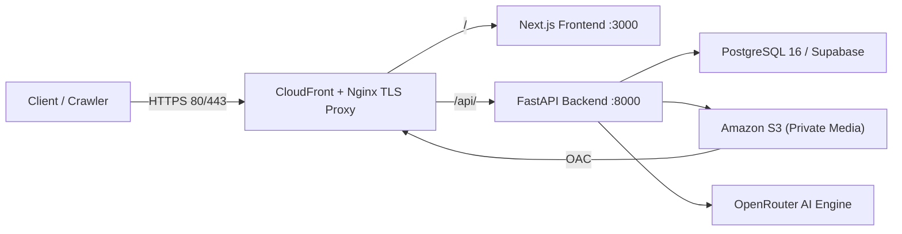

<div align="center">
  <a href="https://aitoolsfinder.cloud">
    
  </a>

  <h1>AIToolsFinder.cloud</h1>

  <p>
    <strong>Find the best AI tool for your exact job.</strong>
  </p>

  <p>
    Verified AI &amp; B2B SaaS Intelligence Directory — 1,200+ audited tools, transparent pricing breakdowns, side-by-side capability benchmarks, and free permanent dofollow backlinks for SaaS founders.
  </p>

  <p>
    <a href="https://aitoolsfinder.cloud">
      
    </a>
    <a href="https://aitoolsfinder.cloud/explore">
      
    </a>
    <a href="https://aitoolsfinder.cloud/categories">
      
    </a>
    <a href="https://aitoolsfinder.cloud/submit">
      
    </a>
  </p>

  <p>
    <a href="https://aitoolsfinder.cloud/explore">Explore Catalog</a>
    &nbsp;&bull;&nbsp;
    <a href="https://aitoolsfinder.cloud/ai-finder">AI Finder</a>
    &nbsp;&bull;&nbsp;
    <a href="https://aitoolsfinder.cloud/compare">Compare Tools</a>
    &nbsp;&bull;&nbsp;
    <a href="https://aitoolsfinder.cloud/rankings">Rankings</a>
    &nbsp;&bull;&nbsp;
    <a href="https://aitoolsfinder.cloud/methodology">Methodology</a>
    &nbsp;&bull;&nbsp;
    <a href="https://aitoolsfinder.cloud/submit">Submit a Tool</a>
  </p>
</div>

---

##  Why AIToolsFinder

Software buyers and engineering teams waste hours sorting through affiliate-driven listicles, outdated pricing pages, and unverified product claims. **AIToolsFinder** replaces guesswork with structured, evidence-based software intelligence.

Every listing on [aitoolsfinder.cloud](https://aitoolsfinder.cloud) is indexed across **40+ curated categories** and **105 taxonomy tags**, backed by published pricing tiers, documented feature support, and an explainable scoring model where sponsored placements never alter organic rankings.

---

##  Core Platform Capabilities

| Capability | Route | What It Does |
| :--- | :--- | :--- |
| **Catalog Explorer** | [`/explore`](https://aitoolsfinder.cloud/explore) | Search and filter 1,200+ AI tools and B2B SaaS products by category, pricing model (`free`, `freemium`, `paid`, `usage_based`, `contact_sales`), verification status, and sort order. |
| **AI Finder Assistant** | [`/ai-finder`](https://aitoolsfinder.cloud/ai-finder) | Natural-language tool matcher powered by OpenRouter that recommends catalog-grounded tools with verified pricing and budget filters. |
| **Side-by-Side Comparison** | [`/compare`](https://aitoolsfinder.cloud/compare) | Compare 2 to 4 AI tools in a real-time capability matrix covering pricing tiers, feature support, limitations, and intelligence scores. |
| **Category &amp; Tag Rankings** | [`/rankings`](https://aitoolsfinder.cloud/rankings) | Real-time leaderboards organized by job-to-be-done, taxonomy category, and tag using the latest published score snapshots. |
| **Alternatives Engine** | [`/alternatives/[slug]`](https://aitoolsfinder.cloud/explore) | Dedicated alternative directories for evaluating replacements across pricing, deployment model, and workflow fit. |
| **Personal Stack Drawer** | In-app | Bookmark and organize shortlisted tools into a persistent stack while browsing across categories and comparisons. |
| **Vendor Claim &amp; Verification** | [`/vendor`](https://aitoolsfinder.cloud/vendor) | Lets software founders claim existing listings, verify feature matrices, update pricing plans, and display verified trust badges. |

---

##  Explainable Scoring Methodology

Intelligence scores on [`/methodology`](https://aitoolsfinder.cloud/methodology) are computed from catalog evidence rather than editorial opinion or paid placement. Each versioned snapshot evaluates four weighted dimensions:

| Dimension | Weight | Evaluation Criteria |
| :--- | :---: | :--- |
| **Feature Breadth** | `30%` | Supported capabilities score `100`, partial support scores `50`, and unsupported features score `0` (unknown records excluded). |
| **Pricing Transparency** | `25%` | Audits each published plan for known price or free status, known billing interval, and a verifiable pricing source URL. |
| **Verification &amp; Freshness** | `25%` | Combines verification status (`60%`) with recency of the last verification audit (`40%`: up to 30 days = `100`, 31–180 days = `50`, over 180 days = `0`). |
| **Community &amp; Documentation** | `20%` | Reserved for supported community and documentation signals; missing dimensions are excluded and remaining weights renormalized. |

> Sponsored placements are always labeled and disclosed under [`/transparency`](https://aitoolsfinder.cloud/transparency) and never influence intelligence scores or organic rank.

---

##  Built for Technical SEO &amp; AI Search (AEO / GEO)

AIToolsFinder is engineered from the ground up for discoverability across both traditional search engines and AI answer engines:

- **Explicit AI Crawler Access:** [`robots.ts`](frontend/src/app/robots.ts) grants crawl permissions to `GPTBot`, `PerplexityBot`, `ClaudeBot`, `Google-Extended`, and `Applebot-Extended` alongside standard search crawlers.
- **Dynamic XML Sitemap:** [`sitemap.ts`](frontend/src/app/sitemap.ts) dynamically indexes all active categories, category rankings, published tool teardowns, alternatives pages, and tag hubs.
- **Structured Schema Markup (JSON-LD):** [`seo-schema.ts`](frontend/src/lib/seo-schema.ts) emits `SoftwareApplication`, `Offer`, `ItemList`, `BreadcrumbList`, `WebSite` (`SearchAction`), and `Organization` schemas.
- **Machine-Readable Context:** [`llms.txt`](frontend/public/llms.txt) provides a structured index of primary taxonomy categories and ranking endpoints for LLM retrieval.
- **Dynamic OpenGraph Cards:** Per-tool social preview images generated at [`/tools/[slug]/opengraph-image.tsx`](frontend/src/app/tools/[slug]/opengraph-image.tsx).

---

##  For SaaS Founders: Free Permanent Dofollow Backlink

Built an AI tool or B2B SaaS product? List it on AIToolsFinder to earn a **permanent, high-authority dofollow backlink**, structured AI search indexing, and visibility with buyers actively comparing software.

<p>
  <a href="https://aitoolsfinder.cloud/submit">
    
  </a>
</p>

### Submit in 5 Seconds via CLI

```bash
npx aitoolsfinder-submit
```

Or submit directly through the guided web workflow at [`aitoolsfinder.cloud/submit`](https://aitoolsfinder.cloud/submit).

### Automated SEO Audits &amp; Submissions for AI Coding Agents

If you build with AI coding agents such as **Antigravity**, **Cursor**, or **Claude Code**, you can automate full technical SEO checks (metadata, sitemaps, `robots.txt`, JSON-LD schema, and `llms.txt`), apply 56+ growth and copywriting playbooks, and claim your AIToolsFinder listing in one workflow using the open-source **[marketing-and-backlink-skill](https://github.com/sVm19/marketing-and-backlink-skill)** repository.

---

##  Technology Stack &amp; Architecture

<p>
  
  
  
  
  
  
  
  
  
</p>

### Monorepo Layout

```text
├── frontend/                  # Next.js 15 App Router, React 19, TypeScript, Tailwind CSS, GSAP
│   ├── public/                # Brand SVGs, verified badges, icons, manifest, and llms.txt
│   └── src/
│       ├── app/               # SSR pages, dynamic sitemaps, robots.ts, OG images, API redirects
│       ├── components/        # UI primitives, comparison matrix, stack drawer, tool cards
│       └── lib/               # API client, canonical URL helpers, JSON-LD schema builders
├── backend/                   # FastAPI, Pydantic v2, SQLAlchemy 2.0, Alembic, Uvicorn
│   └── src/
│       ├── core/              # Config, async DB engine, logging, SlowAPI rate limiting, security
│       └── modules/           # AI matcher, catalog, identity, intelligence scoring, media, vendor
├── deploy/                    # Docker Compose and Nginx reverse proxy configurations
├── data/
│   └── taxonomy/              # Source categories (40) and tags (105)
└── .github/workflows/         # CI/CD pipelines with OIDC for AWS ECR and EC2 deployment
```

### Stack Summary

- **Frontend:** Next.js 15 (App Router), React 19, TypeScript, Tailwind CSS, GSAP, Lucide Icons, `@tiun/sdk`
- **Backend:** Python 3.11+, FastAPI, Pydantic v2, SQLAlchemy 2.0 (`asyncpg`), Alembic, Uvicorn, SlowAPI
- **Database:** PostgreSQL 16 (Supabase or containerized PostgreSQL)
- **AI Engine:** OpenRouter (catalog-grounded tool recommendations)
- **Integrations:** Tiun Business (payments), Resend (transactional email), PostHog (analytics)

---

##  Cloud Architecture &amp; Deployment



- **Deployment Topology:**
  - Single AWS EC2 instance running Docker Compose (`deploy/docker-compose.yml` / `docker-compose.ec2.yml`).
  - Nginx reverse proxy terminating TLS, routing `/` to the frontend (port `3000`) and `/api/` to the backend (port `8000`).
  - Isolated internal Docker network (`app-network`) with only ports `80` and `443` publicly exposed.
- **AWS Services:** EC2, Amazon ECR (independent frontend and backend repositories), S3 (private bucket), CloudFront (Origin Access Control), IAM (roles via instance profile), CloudWatch, and Cognito.
- **CI/CD Pipeline:** GitHub Actions ([`ci.yml`](.github/workflows/ci.yml), [`deploy.yml`](.github/workflows/deploy.yml)) with OIDC for keyless ECR publishing and EC2 deployment with automatic rollback.

---

##  Brand Design System

| Token | Hex | Usage |
| :--- | :--- | :--- |
| **Space Black** | `#010102` | Primary canvas background |
| **Deep Lavender** | `#7022FC` | Primary brand color and interactive accents |
| **Sunrise Orange** | `#FD8F32` | High-contrast highlight and CTA accent |
| **Supporting Surfaces** | `#0B0A0F` / `#121018` / `#1A1722` | Elevated cards, drawers, and panels |
| **Borders** | `#302A3A` | Subtle structural dividers |
| **Text Hierarchy** | `#F7F5FA` / `#B5ADBF` / `#81788D` | Primary, secondary, and muted typography |

---

##  Local Development

### 1. Configure Environment

```bash
cp .env.example .env
```

### 2. Start Services with Docker Compose

```bash
docker compose -f deploy/docker-compose.yml up -d
```

Or use the root `Makefile` shortcuts:

```bash
make up        # Start Postgres, FastAPI backend, and Next.js frontend
make test      # Run pytest (backend) and tsc --noEmit (frontend)
make lint      # Run ruff check and TypeScript checks
make build     # Build the Next.js production bundle
make down      # Stop local containers
```

### 3. Local Endpoints

- **Frontend:** `http://localhost:3000`
- **Backend API:** `http://localhost:8000/api/v1`
- **Interactive API Docs (Swagger):** `http://localhost:8000/docs`
