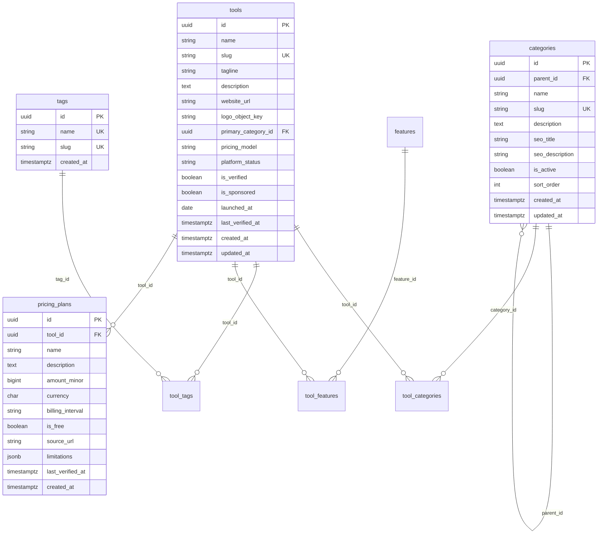

# Implementation Plan — Phase 1: Catalog Foundation

**Official Domain:** [https://aitoolsfinder.cloud](https://aitoolsfinder.cloud)  
**Database:** PostgreSQL 16 (Supabase Managed DB or Containerized DB)  
**Backend Application:** `backend/` (FastAPI Modular Monolith)  
**Status:** Completed  
**Exit Criteria:** Database models and migrations applied; 40 categories and 105 tags seeded; Admin CRUD operational with 100% test coverage.

---

## 1. Objectives & Scope

Phase 1 establishes the relational catalog foundation in **PostgreSQL**. It implements the core entities, constraints, migrations, seed importers, and admin/public API endpoints that power every discovery feature on `https://aitoolsfinder.cloud`.

### In Scope
1. **PostgreSQL Database Schema Setup:**
   - Extensions: `uuid-ossp`, `pg_trgm`.
   - Core tables: `categories`, `tags`, `tools`, `tool_categories`, `tool_tags`, `features`, `tool_features`, `pricing_plans`.
2. **Alembic Database Migration:**
   - Migration script `0001_initial_catalog_schema.py`.
   - Reversible upgrade and downgrade support.
3. **Taxonomy Importer:**
   - Script `backend/scripts/seed_taxonomy.py` parsing `data/taxonomy/source-taxonomy-categories.txt` (40 entries) and `source-taxonomy-tags.txt` (105 entries).
   - Idempotent execution (`ON CONFLICT DO UPDATE/NOTHING`).
4. **Backend Catalog Module (`backend/src/modules/catalog/`):**
   - SQLAlchemy 2.0 mapped models.
   - Pydantic v2 validation schemas.
   - Repository & Service layers separating database queries from route handlers.
   - Public GET endpoints: `/api/v1/categories`, `/api/v1/tags`, `/api/v1/tools/{slug}`.
   - Admin CRUD endpoints: `/api/v1/admin/categories`, `/api/v1/admin/tags`, `/api/v1/admin/tools`.
5. **Testing & Quality Assurance:**
   - Pytest suite covering catalog validation, slug generation, relationships, and error handling.

### Out of Scope for Phase 1
- Full-text search and complex filter queries (Phase 3).
- Tool comparisons and intelligence scoring (Phase 4).
- User authentication and bookmarks (Phase 6).

---

## 2. Technical Architecture & Schema Contract

### 2.1 Entity Relationship Diagram (Mermaid)

### 2.2 Database Conventions
- **Primary Keys:** UUID v4 (`gen_random_uuid()`).
- **Timestamps:** UTC `timestamptz` default `timezone('utc', now())`.
- **Currencies:** Stored strictly as `amount_minor` (e.g. `2900` = $29.00) with 3-character ISO code `currency = 'USD'`. Zero floating-point arithmetic.
- **Slugs:** Normalized lowercase strings with hyphens (e.g. `developer-tools`, `video-creation`).

---

## 3. Step-by-Step Task Checklist

- [x] **Task 1.1: Database Configuration & Connectivity**
  - Verify PostgreSQL connection string format in `backend/src/core/config.py`.
  - Enable SSL requirement for managed database (e.g. Supabase `ssl=require`).
  - Verify connection pool settings for session pooler / direct connection.

- [x] **Task 1.2: SQLAlchemy Declarative Models (`backend/src/modules/catalog/models.py`)**
  - Implement `CategoryModel`, `TagModel`, `ToolModel`, `ToolCategoryModel`, `ToolTagModel`, `FeatureModel`, `ToolFeatureModel`, `PricingPlanModel`.
  - Configure foreign keys, cascading delete rules, indexes, and unique constraints.

- [x] **Task 1.3: Alembic Initial Migration**
  - Generate migration script: `alembic revision --autogenerate -m "create_catalog_tables"`.
  - Verify migration file creates `uuid-ossp` and `pg_trgm` extensions, tables, and indexes.
  - Test migration `upgrade head` and `downgrade -1`.

- [x] **Task 1.4: Taxonomy Seeding Script (`backend/scripts/seed_taxonomy.py`)**
  - Parse `data/taxonomy/source-taxonomy-categories.txt` (40 categories).
  - Parse `data/taxonomy/source-taxonomy-tags.txt` (105 tags).
  - Idempotent upsert logic preserving display names and generating canonical URL slugs.

- [x] **Task 1.5: Pydantic Schemas (`backend/src/modules/catalog/schemas.py`)**
  - Create, Update, and Read schemas for Categories, Tags, Tools, Features, and Pricing Plans.
  - Enforce URL validation on `website_url` and ISO 4217 validation on `currency`.

- [x] **Task 1.6: Service & Repository Layer (`backend/src/modules/catalog/service.py`)**
  - Repository handles atomic database operations.
  - Service handles business logic: slug collision resolution, verification timestamp updates, category assignment validation.

- [x] **Task 1.7: API Router & Endpoints (`backend/src/modules/catalog/router.py`)**
  - Public routes:
    - `GET /api/v1/categories` (paginated or hierarchical list)
    - `GET /api/v1/categories/{slug}` (single category with metadata)
    - `GET /api/v1/tags` (paginated tag list)
    - `GET /api/v1/tools/{slug}` (published tool detail)
  - Admin routes:
    - `POST /api/v1/admin/categories`
    - `PATCH /api/v1/admin/categories/{id}`
    - `POST /api/v1/admin/tags`
    - `POST /api/v1/admin/tools`
    - `PATCH /api/v1/admin/tools/{id}`
    - `POST /api/v1/admin/tools/{id}/publish`

- [x] **Task 1.8: Integration Tests & Verification**
  - Test taxonomy seed script execution.
  - Test category, tag, and tool CRUD endpoints via Pytest.
  - Test slug uniqueness constraints and error responses.

---

## 4. Milestone Exit Criteria

1. Database schema matches `DATABASE_SCHEMA.md`.
2. All 40 source categories and 105 tags are seeded and accessible via `/api/v1/categories` and `/api/v1/tags`.
3. Admin can create, update, and publish a tool record with pricing plans and category associations.
4. Pytest test suite passes with 100% green status.
